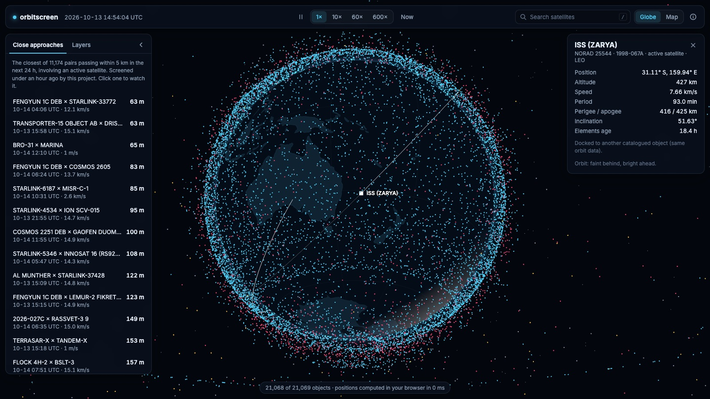
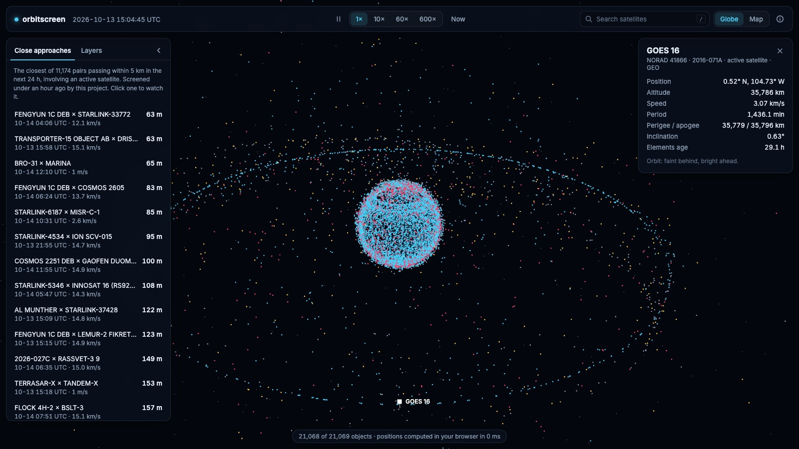

# 6. The live tracker



The screener's output is a list of numbers. The tracker shows what the catalog actually looks like: every object, moving in real time on a world map. It reuses the same SGP4 propagator and catalog loader. The one new piece of maths turns SGP4's positions into latitude and longitude.

**Try it: [supremeinferno.github.io/orbitscreen](https://supremeinferno.github.io/orbitscreen/)**, or run it locally:

```sh
go run ./cmd/fetch     # if data/ is missing or old
go run ./cmd/track     # then open http://localhost:8080
```

Click any dot, or search by name or NORAD number, to see the object's ground track, coverage footprint and orbit details. The selection is kept in the URL (`#25544` is the ISS), so a view can be shared. The speed buttons run the clock at 10×, 60× or 600× to watch whole orbits go by.

## What you're looking at

- **Dots** are coloured by kind: active satellites, inactive satellites, rocket bodies and debris (from the catalog's naming convention: `… DEB`, `… R/B`). The orbit-class buttons filter by LEO, MEO, GEO and HEO.
- **The line of dots along the equator** is the geostationary belt. Those satellites orbit once per sidereal day, so they hang over one spot.
- **The dense band with a sharp edge at about ±53° latitude** is mostly Starlink. A ground track can't reach further from the equator than the orbit's inclination (or 180° minus it, for retrograde orbits), so each shell of satellites fills a band. Starlink's main shells are at 53°, and sparser ones at 43°, 70° and 97.6° fill bands up to ±43°, ±70° and ±82°.
- **The darker half** is night. The yellow dot is the point directly below the Sun.
- **For the selected object:** the bright line is its ground track for the next orbit, the faint line the last third of an orbit, and the circle is its *footprint*, the area from which it is above the horizon.

## From TEME to latitude and longitude

SGP4 gives positions in **TEME**, a frame that doesn't rotate with the Earth ([chapter 2](02-sgp4.md#output-frame-teme)). A map needs coordinates fixed to the ground. [`internal/earth`](../internal/earth/earth.go) does it in two steps.

**1. Rotate by sidereal time.** The Earth turns about its axis once per sidereal day. The angle it has turned, *Greenwich mean sidereal time* (GMST), is exactly the rotation between TEME and the Earth-fixed frame:

```
x_ecef =  cos(θ)·x + sin(θ)·y
y_ecef = −sin(θ)·x + cos(θ)·y          θ = GMST(t)
z_ecef =  z
```

GMST uses the same IAU-82 formula SGP4 uses internally, now exported as `sgp4.GMST`. It is tested against the worked example in Vallado's textbook (1992-08-20 12:14 UT1 → 152.578787810°).

**2. Convert to geodetic coordinates.** Longitude is just `atan2(y, x)`. Latitude is harder because the Earth isn't a sphere. It's flattened by about 1/298, so "straight up" from the ground doesn't point at the Earth's centre. `ECEFToGeodetic` finds the latitude on the WGS-84 ellipsoid by fixed-point iteration. Five rounds give sub-millimetre accuracy at any altitude, which a round-trip test (geodetic → ECEF → geodetic, including the poles and GEO altitude) checks.

### How accurate is it?

The conversion was checked against [Skyfield](https://rhodesmill.org/skyfield/), an astronomy library that uses the full IAU Earth-rotation model, for 2,049 objects at the same instant:

| | Max difference |
|---|---|
| Altitude | 0.00 m |
| Ground position | 41.9 m |

The 41.9 m is fully explained. We use UTC as the time for Earth's rotation; the precise quantity is UT1, which differs from UTC by 0.0902 s on that date, and the equator moves 42.0 m in 0.0902 s. Polar motion (~10 m) is also ignored. Both are invisible on a world map and tiny next to TLE errors (kilometres). They would matter for pointing a telescope, not for a map.

## Architecture

```
browser                                          cmd/track (Go)
───────                                          ──────────────
GET /api/catalog   once  ───────────────────────▶ names, kinds, orbit classes (JSON)
GET /api/positions?t=…   every 1 s (¼ s when     ▶ SGP4 + TEME→geodetic for all ~20k
                         time-warping)              objects, 12 bytes each (binary)
GET /api/object?id=…&t=… every 3 s for the       ▶ details + 241-point ground track (JSON)
                         selected object
```

All the orbit maths runs in Go. The browser only draws. The page itself (HTML, CSS, JS) is embedded in the binary with `go:embed`, so `cmd/track` is a single self-contained program.

**Positions are sent as binary.** Each object is three little-endian `float32`s (latitude, longitude, altitude), in the same order as the catalog: 245,868 bytes for 20,489 objects. The browser wraps the response in a `Float32Array` with no parsing at all. The same data as JSON would be about three times larger and need parsing every second. `float32` has ~7 significant digits, about 1 m of latitude, which is plenty for a map.

**Speed.** Propagating and converting the whole catalog for one request takes about **10 ms** on one core, measured in the browser as the round-trip time and shown in the legend. That's why the server can afford to recompute everything every second instead of streaming deltas or interpolating.

## The 3D view

The tracker opens on a **3D globe** ([`globe.js`](../cmd/track/web/globe.js), drawn with [three.js](https://threejs.org/)); the flat map is one click away. Every object sits at its real altitude, so the shells are visible: the dense LEO cloud, the navigation satellites around 20,000 km, and the geostationary ring when you zoom out. The scene is Earth-fixed, the same frame as the latitudes and longitudes the engine returns: the Earth stays still, the Sun's light moves (from the same solar position the map uses for its night shading), and the satellites move around it. The Earth's texture is the flat map's own drawing, painted onto a 4096×2048 canvas.



The 21,000 objects are one `THREE.Points` object, refreshed every second from the same position buffer the map uses. Picking works on screen: each visible object is projected to the screen, objects behind the Earth (the line from the camera to them passes through the sphere) are skipped, and the nearest within 12 px wins. Selecting an object turns the camera to look down on it (high orbits from 25° above, so the geostationary belt shows as a ring); its orbit is drawn at its altitude, from the ground-track points, which now carry altitude too.

The controls are grouped so the globe stays in view: time on the top bar, close approaches and layer filters as tabs in one side panel that folds away, the selected object on the right, and a small status line at the bottom. Also: a pause button and keyboard shortcuts (<kbd>/</kbd> search, <kbd>Space</kbd> pause, <kbd>Esc</kbd> clear), and a few well-known objects (ISS, Tiangong, Hubble) suggested in the empty search box.

## The public site: the same Go code in the browser

GitHub Pages can only host static files, so it can't run `cmd/track`'s server. Instead of rewriting the maths in JavaScript, the site runs the **same Go code compiled to WebAssembly**. The tracker's computations live in [`internal/live`](../internal/live/live.go), which both programs use:

```
cmd/track (local)                         public site
─────────────────                         ───────────
browser ── HTTP ──▶ Go server             browser ── calls ──▶ Go compiled to WebAssembly
                    internal/live                              internal/live (cmd/trackwasm)
```

The page talks to one small file, `api.js`, with three functions: `catalog()`, `positions(t)` and `object(id, t)`. Locally, [its version](../cmd/track/web/api.js) makes the HTTP requests above. The [site's version](../site/api.js) downloads the WebAssembly engine (~1 MB compressed) and the element sets (~3 MB of CSV), then calls the engine directly. Nothing else in the page changes.

**Speed.** One `positions` call for 21,069 objects takes about **30 ms** as WebAssembly (measured in Node.js on the M4), against ~10 ms natively. Fast enough to recompute everything every second, or 4 times a second when time-warping, without a Web Worker.

**Close approaches.** The site also lists the next day's closest approaches. When the site is built, [`site/closest`](../site/closest/main.go) runs this project's grid screener ([chapter 5](05-screening.md)) for 24 hours, SOCRATES-style: pairs involving an active satellite, but not two active satellites of the same fleet, which their operator handles. It keeps the 30 closest pairs as JSON. That takes ~25 s on the M4's 10 cores, about a minute on GitHub's runners. Clicking one jumps the clock to a minute before closest approach, with both objects highlighted and a countdown. On the first build: 11,092 pairs within 5 km in a day, the closest at 63 m (a Fengyun-1C fragment and a Starlink, 12 km/s apart).

**Fresh data.** A [GitHub Action](../.github/workflows/site.yml) fetches the element sets from CelesTrak every 6 hours, builds the site with [`site/build.sh`](../site/build.sh) and deploys it. Data is cached in 2-hour slots, so pushes never fetch from CelesTrak more often than it asks.

## The map

The map is drawn on a `<canvas>` without a mapping library. The projection is **equirectangular**: longitude maps linearly to x and latitude to y. That's the simplest projection, and the one ground tracks are traditionally drawn on. Coastlines come from Natural Earth's 1:110m land data (via the `world-atlas` package), decoded with `topojson-client`.

Three details took some care:

- **The ±180° edge.** A line from longitude 179° to −179° is 2° long, but drawn naively it spans the whole map. Ground tracks and footprints break the line wherever consecutive points are more than 180° apart. Coastlines that cross the edge (eastern Russia, Fiji, Antarctica) are "unwrapped" so longitude changes smoothly past 180°, then drawn three times (shifted by −360°, 0° and +360°), with the map rectangle clipping off whatever falls outside. The first version skipped this and drew two lines straight across the Arctic.
- **Night.** The Sun's position comes from the Astronomical Almanac's low-precision formula (good to ~0.01°). The *terminator*, where the Sun is on the horizon, is at latitude atan(−cos(Δlon) / tan(δ☉)) for each longitude, where δ☉ is the Sun's declination. Everything between that curve and the pole facing away from the Sun is shaded.
- **Footprints.** An object at altitude *h* is above the horizon within an angular radius ρ = arccos(R / (R + h)) of its ground point. That's ~20° for the ISS and ~81° for GEO. The circle is computed with spherical trigonometry and looks stretched on the map, because equirectangular stretches everything away from the equator.

## Tests

[`cmd/track/main_test.go`](../cmd/track/main_test.go) runs the HTTP API against a three-object catalog (the ISS, a piece of Cosmos 2251 debris, GOES 16). It checks:

- object kinds and orbit classes;
- that the binary position buffer has the right size and plausible values (GEO altitude within 100 km of 35,786 km, ISS latitude never beyond its 51.6° inclination);
- that the ground track's "now" point matches the current position;
- unknown IDs return 404.

← [5. Screening](05-screening.md) · [7. Optimisation →](07-optimisation.md)
